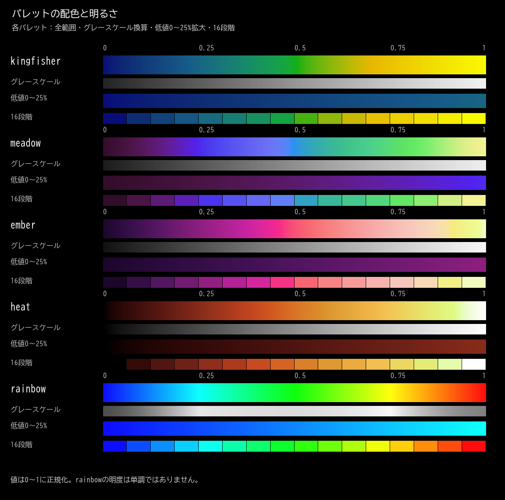

# パレット

重ね合わせ画像の層番号による色分けには、次の5種類のパレットを使用できます。kingfisherが標準です。カラーバーの左が小さい層番号、右が大きい層番号に対応します。



図には、全範囲の配色、グレースケール換算、低値側0〜25%の拡大、16段階の配色を示しています。背景は黒です。

## 配色

| パレット | 低値から高値への配色 | CIE L*の設計範囲 |
| --- | --- | --- |
| kingfisher | 青 → 青緑・エメラルドグリーン → 緑・黄緑 → 金色 → 黄色 | 14〜95 |
| meadow | 紫 → 青 → 緑 → 明るい黄色 | 10〜94 |
| ember | 暗い紫 → 赤 → 黄色 | 5〜97 |
| heat | 黒 → 赤 → 黄 → 白 | 0〜100 |
| rainbow | 青 → 水色 → 緑 → 黄 → 赤 | 明度は非単調 |

kingfisherはカワセミをイメージした配色です。入力範囲の約42%にエメラルドグリーン、約70%に金色を配置しています。最高値は鮮やかな黄色（RGB 249, 249, 0）です。

## 明度カーブ

kingfisher / meadow / ember / heatは、黒背景で低値側の差を見分けやすくするため、低値側に大きな明度勾配を割り当てています。値を0〜1に正規化したtに対し、明度の位置を次の式で定めます。

```text
f(t) = t + 0.35t(1 − t)
L*(t) = L*min + (L*max − L*min) f(t)
```

L*min、L*maxは表に示した設計範囲の両端です。f(t)の傾きは0.65〜1.35で、全範囲に明度勾配があります。色はsRGB色域内で生成し、8bit化の際には輝度の逆転を防ぐ局所補正を行います。

rainbowはHSVの色相に沿う配色で、この明度カーブは適用しません。明度が単調に増加する必要がある場合は、他の4種類を使用してください。

## 性質と用途上の注意

kingfisher / meadow / ember / heatは、8bitの256色がすべて異なり、sRGBから算出した相対輝度が厳密に増加します。グレースケール換算の明るさが途中で逆転しない配色です。知覚的な色差は完全に均一ではなく、色覚特性によって色の識別性は異なります。

図はパレット自体の配色を示します。「値で明度を変える」を有効にした重ね合わせ画像では、画素値によって表示色の明るさも変わります。操作方法は[重ね合わせ・出力](usage_ja.md#重ね合わせ出力)を参照してください。

## ライセンス

パレットの生成コードと配色は[MITライセンス](../LICENSE)で提供します。アプリの依存ライブラリのライセンスは[第三者ライセンス](../THIRD_PARTY_NOTICES.txt)を参照してください。
